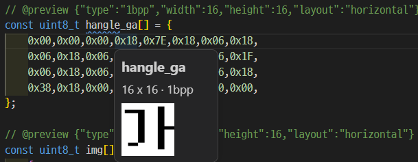

# C Array Image Preview for Visual Studio Code

[View on VS Code Marketplace](https://marketplace.visualstudio.com/items?itemName=Crem2y.c-array-image-preview)

[Support me on Ko-fi!](https://ko-fi.com/crem2y)



Preview embedded bitmap and image data directly from C and C++ source code in Visual Studio Code.

C Array Image Preview reads metadata from a source comment, parses the associated array, and renders the result when you hover over the array name or its contents.

Supported formats: packed/unpacked 1bpp and RGB565 little-endian byte arrays.

## Features

- Preview C and C++ array data on hover
- Explicit metadata-based format selection
- 1bpp bitmap rendering
- RGB565 color rendering from little-endian 8-bit arrays
- Horizontal and vertical data layouts
- Support for .c, .h, .cpp, and .hpp files

## Usage

Add an `@preview` annotation immediately above the array.

```c
/**
 * @brief Example 1bpp image
 * @preview {"type":"1bpp","width":16,"height":16,"layout":"horizontal"}
 */
const uint8_t example_image[] = {
    0xFF, 0xFF,
    0x80, 0x01,
    0x80, 0x01,
    0x8C, 0x31,
    0x8C, 0x31,
    0x80, 0x01,
    0x81, 0x81,
    0xC0, 0x03,
    0xA0, 0x05,
    0x90, 0x09,
    0x8F, 0xF1,
    0x80, 0x01,
    0x80, 0x01,
    0x80, 0x01,
    0x80, 0x01,
    0xFF, 0xFF
};
```

### Pixel packing

`packing` is optional and defaults to `"packed"`, where each array element
stores eight pixels, most significant bit first. Existing annotations work unchanged.

Use `"packing":"unpacked"` for arrays with one `0` or `1` per pixel:

```c
// @preview {"type":"1bpp","width":4,"height":2,"layout":"horizontal","packing":"unpacked"}
const uint8_t image[] = {
    0, 1, 0, 1,
    1, 0, 1, 0
};
```

For unpacked data, `horizontal` reads row by row and `vertical` reads column
by column. Both require `width * height` elements, without bit padding.

### RGB565

Use `"type":"rgb565"` for an 8-bit array containing two bytes per pixel,
low byte first (little-endian). Each 16-bit pixel contains red in bits 15–11,
green in bits 10–5, and blue in bits 4–0.

```c
// @preview {"type":"rgb565","width":3,"height":2,"layout":"horizontal"}
const uint8_t colors[] = {
    0x00, 0xF8, // Red:   0xF800
    0xE0, 0x07, // Green: 0x07E0
    0x1F, 0x00, // Blue:  0x001F
    0xFF, 0xFF, // White
    0x00, 0x00, // Black
    0x10, 0x84  // Gray
};
```

`horizontal` reads pixels row by row; `vertical` reads column by column.
Both require `width * height * 2` bytes. Omit `packing` (defaults to `packed`);
`unpacked`, 16-bit array elements, and big-endian data are not supported for RGB565.

### Preview size

Both formats use integer pixel scaling (1×–4×). The largest scale that keeps
the longer side within 256 pixels is selected, capped at 4×. Images already
larger than 256 pixels are shown at 1× without downscaling.

## How to build

```bash
# install dependencies
npm ci

# build extension
npm run compile
```

To try the extension, open this project in Visual Studio Code and press `F5`
to launch the Extension Development Host. In the new window, open a C or C++
file containing the example above and hover over the array name or its contents.

## Release Notes

### 1.0.0

First stable release with packed/unpacked 1bpp, little-endian RGB565,
horizontal/vertical layouts, and automatic 1×–4× integer scaling.

See [CHANGELOG.md](CHANGELOG.md) for release history.
